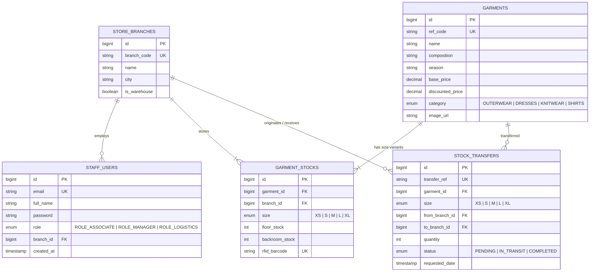

# ZaraStyle — Enterprise Fashion Inventory & Supply Logistics


An enterprise-grade **Fashion Retail & Supply Chain Logistics Web Application** inspired by **Zara / Inditex fast-fashion systems**, configured for deployment on **Apache Tomcat (WAR packaging)**, and verified across all **4 tiers of software testing** (Unit, Integration, Playwright E2E, and Manual QA).

---

##  Core Zara Retail Features Implemented

* **Size Matrix Inventory (XS, S, M, L, XL):** Real-time stock counts tracked independently per garment, per size variant, and per store branch.
* **Dual-Zone Stock Tracking:** Segregating inventory on the **Sales Floor** vs. **Backroom Stock Storage**.
* **RFID / Barcode Instant Scan Simulation:** Sub-second SKU lookup (`ZARA-7941-PAR-M`) revealing exact garment details and stock distribution.
* **Sales Floor Replenishment:** One-click stock movements from Backroom $\to$ Sales Floor with automated balance adjustments.
* **Inter-Store Replenishment Transfers:** Transferring bulk inventory between the **Arteixo Central Distribution Hub** and flagship stores (**Paris Champs-Élysées**, **London Oxford St**).
* **Seasonal Markdown Engine:** Dynamic percentage discount reductions across fashion collections.
* **Staff Role-Based Security (RBAC):**
  * `ROLE_ASSOCIATE`: Store associates (RFID scans, floor replenishments).
  * `ROLE_MANAGER`: Store managers (Markdown discounts, inter-branch transfer requests).
  * `ROLE_LOGISTICS`: Distribution center operators (Dispatching and fulfilling stock transfers).

---

## Database Architecture & Entity Relationships

The application uses a normalized MySQL database structure:



---

## Multi-Tier QA Testing Architecture

```text
       /\
      /  \        4. Manual QA Pack (Master Test Plan, RTM, Jira-Style Defects)
     /----\
    /      \      3. E2E Browser Automation (Playwright & TypeScript with POM)
   /--------\
  /          \    2. Integration Testing (Spring MockMvc, Session, Security RBAC)
 /------------\
/              \  1. Unit Testing (JUnit 5, Mockito, Size Matrices, Markdowns)
----------------
```

### 1. Unit Testing (JUnit 5 + Mockito)
* Located in: [`src/test/java/com/zarastyle/unit/`](src/test/java/com/zarastyle/unit/)
* `GarmentServiceTest`: Verifies sales floor replenishments, backroom stock validations, and discount markdown math.
* `StockTransferServiceTest`: Validates inter-branch quantity constraints, origin backroom stock deductions, and destination additions.

### 2. Integration Testing (Spring Boot Test + MockMvc)
* Located in: [`src/test/java/com/zarastyle/integration/`](src/test/java/com/zarastyle/integration/)
* `GarmentControllerIntegrationTest`: Tests catalog listings, RFID barcode scan endpoint (success and 404), and floor replenishment.
* `StockTransferIntegrationTest`: Verifies role security (Store Associates blocked with HTTP 403 Forbidden; Managers authorized to request transfers).

### 3. End-to-End Automation (Playwright & TypeScript)
* Located in: [`e2e-tests/`](e2e-tests/)
* Implements the **Page Object Model (POM)**:
  * `rfid-scan-and-replenish.spec.ts`: Simulates associate barcode scan, modal inspection, and sales floor replenishment.
  * `markdown-pricing.spec.ts`: Store manager applying 20% seasonal markdown and verifying price strikethrough updates.

### 4. Manual QA Documentation Pack
* Located in: [`qa-manual-artifacts/`](qa-manual-artifacts/)
* [`01-test-plan.md`](qa-manual-artifacts/01-test-plan.md): Retail supply chain test strategy and risk matrix.
* [`02-requirements-traceability-matrix.md`](qa-manual-artifacts/02-requirements-traceability-matrix.md): Full traceability mapping requirements to Unit, Integration, E2E, and Manual test cases.

---

##  Running on Apache Tomcat (Localhost)

### Option A: Run Embedded Tomcat (1-Click)
```powershell
cd zara-fashion-inventory
mvn spring-boot:run
```
Open your browser at:
* **Store Inventory Console:** `http://localhost:8080/`
* **Transfers Portal:** `http://localhost:8080/transfers.html`
* **H2 Database Console:** `http://localhost:8080/h2-console`

**Pre-seeded Demo Staff Accounts:**
* Store Manager: `manager@zara.com` / `ZaraManager123!`
* Floor Associate: `associate@zara.com` / `ZaraStaff123!`
* Central Logistics: `logistics@zara.com` / `ZaraLogistics123!`

---

### Option B: Deploy to Standalone Apache Tomcat 10+
1. Package the WAR archive:
   ```powershell
   mvn clean package -DskipTests
   ```
2. Copy `target/zara-system.war` to your Tomcat `webapps/` folder:
   ```powershell
   Copy-Item "target\zara-system.war" "C:\apache-tomcat-10.x\webapps\zara-system.war"
   ```
3. Start Tomcat (`bin\startup.bat`) and visit:
   `http://localhost:8080/zara-system/`

*(See [`tomcat-deployment/tomcat-setup-guide.md`](tomcat-deployment/tomcat-setup-guide.md) for full instructions).*

---

##  Execute the Automated Test Suite

### Run Unit & Integration Tests (14 Tests)
```powershell
mvn test
```

### Run Playwright E2E Automation
```powershell
cd e2e-tests
npm install
npx playwright test
```

---

## 👤 Author

* **QA & SDET Engineer:** Samir Boussada
* **GitHub Profile:** [@samir-boussada](https://github.com/samir-boussada)
* **LinkedIn:** [Https://www.linkedin.com/in/samir-boussada-5bba06113]
